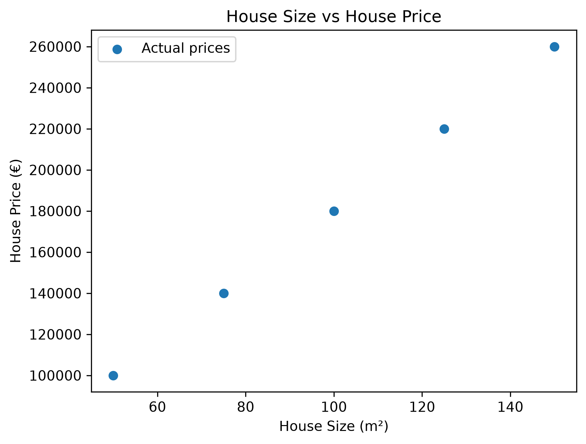
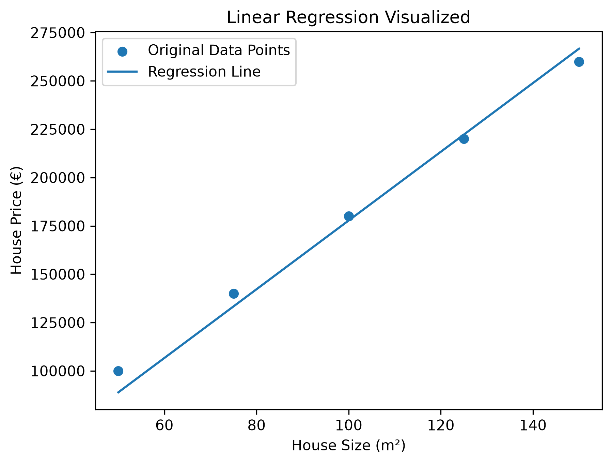
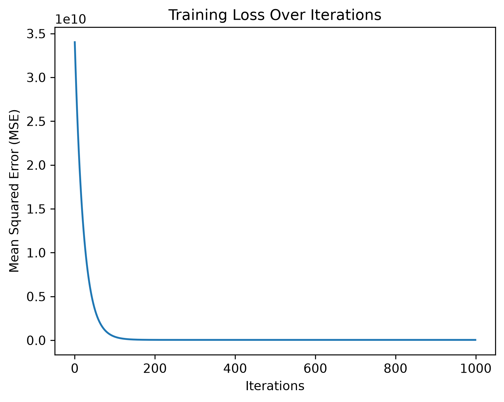

# Linear Regression From Scratch

A simple linear regression model implemented from scratch using Python, NumPy, and Matplotlib — without relying on machine learning libraries such as Scikit-learn.

This project explores the mathematics and implementation behind linear regression, including prediction, Mean Squared Error, gradient descent, model evaluation, and feature scaling.

## Project Overview

The goal of this project was to understand how linear regression works internally by implementing the algorithm step by step.

The model learns the relationship between house size and house price using a small, artificially generated dataset.

**Dataset features:**
- Input (X): House size in square meters.
- Target (y): House price in euros.

The underlying relationship in this artificial dataset is:

$$
y = 1600x + 20000
$$

## Technologies Used

- Python
- NumPy
- Matplotlib
- Jupyter Notebook

## What I Implemented

- **Data exploration:** Examined the dataset using mean, standard deviation, and correlation.
- **Prediction function:** Implemented the linear equation using weight and bias.
- **Mean Squared Error (MSE):** Measured the model's prediction error.
- **Gradient descent:** Calculated gradients and updated model parameters to minimize the loss.
- **Training function:** Automated the training process over multiple iterations.
- **Visualization:** Plotted predictions, regression lines, and loss curves.
- **Model evaluation:** Tested predictions on unseen data.
- **Feature scaling:** Applied standardization and explored its effect on gradient descent.

## Project Structure

```text
Linear-Regression/
│
├── images/
│   ├── dataset.png
│   ├── regression_line.png
│   └── loss_curve.png
│
├── linear_regression.ipynb
├── requirements.txt
└── README.md
```

## Getting Started

### 1. Clone the repository

```bash
git clone https://github.com/natandrew/Linear-Regression
```

### 2. Navigate to the project folder

```bash
cd Linear-Regression
```

### 3. Create a virtual environment (optional but recommended)

```bash
python -m venv venv
```

Activate it on Windows:

```bash
venv\Scripts\activate
```

### 4. Install dependencies

```bash
pip install -r requirements.txt
```

### 5. Launch Jupyter Notebook

```bash
jupyter notebook
```

Open the notebook and run its cells from top to bottom.

## Visualizations

### Dataset



### Regression Line



### Loss Curve



## What I Learned

Through this project, I gained practical experience with:

- Translating mathematical concepts into Python code.
- Understanding how weights and biases influence predictions.
- Calculating derivatives and gradients.
- Understanding how gradient descent minimizes a loss function.
- Choosing a suitable learning rate.
- Understanding why feature scaling matters during optimization.
- Evaluating a model using training and test data.
- Building a machine learning algorithm without relying on high-level ML libraries.

Most importantly, this project helped me understand the mechanics behind one of the fundamental algorithms in machine learning.

## Limitations

This project uses a small, artificially generated dataset with a perfectly linear relationship. Therefore, its results demonstrate the algorithm's mechanics rather than real-world predictive performance.

---

**Project:** Linear Regression From Scratch  
**Focus:** Learning the fundamentals of machine learning through implementation.